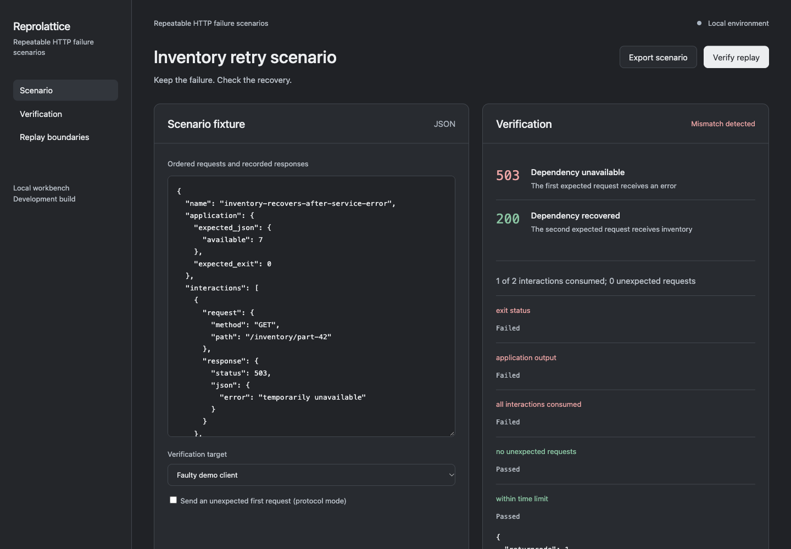

# Reprolattice

Turn an HTTP failure case into a portable, verifiable scenario.

## Run the workbench

From a source checkout with Python 3.10 or later:

```sh
python3 -m reprolattice.web
```

Open http://127.0.0.1:8413. No third-party runtime packages are required.
The workbench is a local development application, not a hosted multi-user service.
Run it from the checkout: bundled examples are not yet distributed in an installed package.

## Workbench preview



## Command line

```sh
python3 -m reprolattice verify examples/retry.json
python3 -m unittest discover -s tests -v
```

## Implemented

Validates and serves ordered HTTP/JSON fixtures on loopback. Matches methods, paths and optional JSON bodies, rejects unexpected calls without upstream forwarding and reports consumed/unexpected interactions. Runs a trusted test application against temporary fixture dependencies, checks its JSON output and exit code, and distinguishes the bundled faulty client from its corrected version. Includes a recursive named-field redaction helper and a browser fixture editor.

## Boundaries

The application harness accepts a trusted local command and checks its final JSON result; it is not an operating-system sandbox and does not prevent that process from making independent network calls. Capture, database snapshots, tracing, concurrency, SDKs and test export are planned. Named-field redaction cannot detect every secret or personal datum. JSON bodies are bounded; streaming and arbitrary protocol replay are unsupported.

## Development scope

[Architecture](docs/ARCHITECTURE.md) explains the current execution path.
[Product scope](docs/PRODUCT_SCOPE.md) describes the broader proposed subsystems.
[Weekly roadmap](docs/proposed-weekly-roadmap.csv) is a planning scenario.
[Tasks](TASKS.md) and [request register](REQUESTS.md) track actual status.

## History note

This repository was assembled starting in November 2026. Earlier Git timestamps,
where used, represent reconstructed development stages, not verified original
work in those years. The 2019–2026 roadmap is proposed scope, not a completed-work record.
