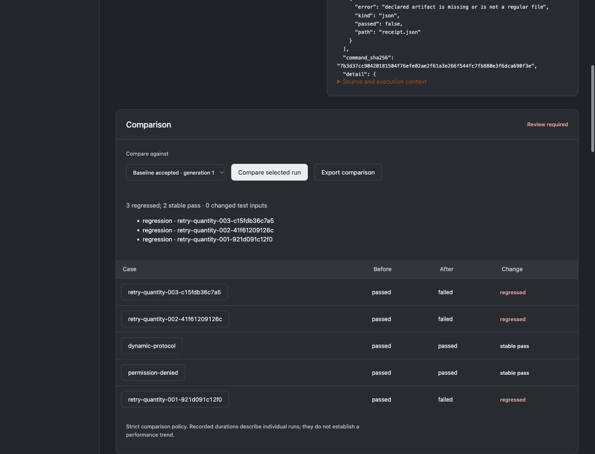

# Reprolattice

Turn an HTTP failure case into a portable, verifiable scenario.

## Run the workbench

From a source checkout with Python 3.10 or later:

```sh
python3 -m reprolattice.web
```

Open http://127.0.0.1:8413. No third-party runtime packages are required.
The workbench is a local development application, not a hosted multi-user service.
Bundled examples are included in the wheel. Runtime state is stored outside the installed package.

## Workbench preview



## Command line

```sh
python3 -m reprolattice verify examples/retry.json
python3 -m unittest discover -s tests -v
```

## Implemented

Validates and serves ordered HTTP/JSON fixtures on loopback. Matches methods, exact or patterned paths, header subsets, query conditions and typed JSON bodies, rejects unexpected calls without upstream forwarding and reports consumed/unexpected interactions. Runs a trusted test application against temporary fixture dependencies, checks its JSON output and exit code, and distinguishes the bundled faulty client from its corrected version. Includes a recursive named-field redaction helper and a browser fixture editor.

Request rules and application assertions are described in [the assertion guide](docs/ASSERTIONS.md). Try `python3 -m reprolattice verify examples/dynamic-order.json` for an executable dynamic-path example.

## Scenario suites

Run `python3 -m reprolattice.suites examples/inventory-suite.json --output .local/control-run --jobs 2` for five real application/protocol cases. The runner preflights all variants, copies explicit workspace inputs, checks declared output artifacts and writes JSON, standalone HTML and JUnit XML reports to a new directory.

The workbench includes the same reviewed suite, a faulty-client comparison and JSON/JUnit downloads. See [suite guide](docs/SUITES.md) for parameter matrices, cancellation, filtering, file identities and current limits.

## Saved run review

The **Saved runs** workbench retains executed suite reports and explains regressions, fixes, changed inputs and missing coverage. Review a complete passing run as a named baseline, retain its generation/reason history, inspect case outcomes across parameter variants and export saved JSON/JUnit or comparison evidence. See the [archive workbench guide](docs/ARCHIVE_WORKBENCH.md) for the complete local workflow and evidence boundaries.

## Boundaries

The application harness accepts a trusted local command and checks its final JSON result; it is not an operating-system sandbox and does not prevent that process from making independent network calls. Explicit HTTP/JSON capture is available through `python3 -m reprolattice.capture`. Database snapshots, tracing, concurrent replay, SDKs and test export remain planned. Named-field redaction cannot detect every secret or personal datum. JSON bodies are bounded; streaming and arbitrary protocol replay are unsupported.


## Capture dependencies

```sh
python3 -m reprolattice.capture http://127.0.0.1:9000 --output captured.json
```

The proxy binds to loopback. Remote targets, write methods and credential-bearing requests each require explicit options. Named secrets are redacted in stored output. Incomplete captures are marked and refused as complete replay scenarios. Duplicate header fields, arbitrary binary payloads and concurrent scheduling replay are unsupported. See [capture guide](docs/CAPTURE.md).

## Installed examples

```sh
python3 -m reprolattice.resources ./demo
```

This exports the reviewed examples to a new directory without overwriting an existing destination. Use the exported paths with the CLI.

## Development scope

[Architecture](docs/ARCHITECTURE.md) explains the current execution path.
[Product scope](docs/PRODUCT_SCOPE.md) describes the broader proposed subsystems.
[Weekly roadmap](docs/proposed-weekly-roadmap.csv) is a planning scenario.
[Tasks](TASKS.md) and [request register](REQUESTS.md) track actual status.

## History note

This repository was assembled starting in November 2026. Earlier Git timestamps,
where used, represent reconstructed development stages, not verified original
work in those years. The 2019–2026 roadmap is proposed scope, not a completed-work record.

## SQLite application state

Suites can create a fresh structured SQLite fixture for each case, run the application and check typed read-only SQL results. Logical snapshots compare schema and rows independently of physical file layout. A bundled inventory example detects omitted database writes even when the HTTP response is correct. See [SQLite state guide](docs/SQLITE_STATE.md); standalone operations are available through `python3 -m reprolattice.sqlite_cli --help`.

## Run registry and regression comparisons

The local registry archives immutable suite reports with source/build revision metadata, indexed case history and generation-fenced named baselines. Comparison distinguishes changed test conditions from changed subject code, regressions/fixes, missing coverage and optional timing thresholds. See [run registry guide](docs/RUNS.md); use `python3 -m reprolattice.runs --help` for operator commands.

[Retained SQLite state workbench](docs/STATE_WORKBENCH.md): actual before/after evidence, typed row differences, bounded local archive and portable verification.
