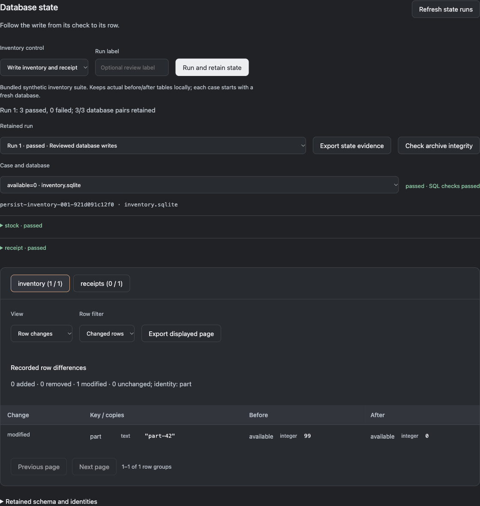
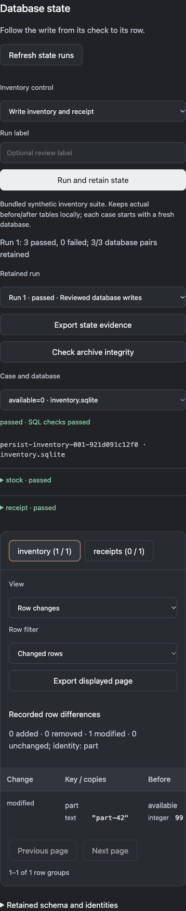

# Retained SQLite state

The state workbench keeps actual before/after SQLite snapshots from a trusted test suite. It links each pair to the case, database path, compiled state contract, recorded SQL checks and logical difference. HTTP success and correct JSON output cannot substitute for a required database write.

## Browser workflow

Open the local workbench and choose **Database state**. The two reviewed synthetic controls run the bundled inventory state suite:

- **Write inventory and receipt**: all three cases pass. Inventory starts at 99, becomes the case's declared quantity (0, 7 or 12), and one receipt appears.
- **Skip database writes**: HTTP/output checks pass, but all three cases fail SQL postconditions. Both tables remain unchanged.

**Run and retain state** saves a separate retained-state run, rather than the five-case inventory HTTP suite above it. Every case gets its own temporary database. The application is stopped before inspection; the before/after snapshots are retained before the temporary workspace is removed. Select a run, case/database pair and table. **Row changes**, **Before execution** and **After execution** read retained evidence, not a live application database.

The table tabs show before/after row counts. SQL check disclosures preserve available typed expected/actual values and diagnostic completeness flags. Large original diagnostics can have been shortened by the suite report; the full retained tables remain separately available. Empty differences do not imply passing postconditions. An incomplete capture is explicitly labeled and does not become a fully retained success.

Browser controls execute only the reviewed bundled client/fixture. They reject browser-supplied programs, arbitrary files, database paths and projects. Actual CLI suites remain trusted local programs, not sandboxed applications.

## CLI workflow

```sh
python -m reprolattice.state_runs --database /tmp/states.sqlite --project inventory run examples/inventory-state-suite.json --request-key first --label 'Reviewed writes'
python -m reprolattice.state_runs --database /tmp/states.sqlite --project inventory list
python -m reprolattice.state_runs --database /tmp/states.sqlite --project inventory inspect RECORD_SHA256
python -m reprolattice.state_runs --database /tmp/states.sqlite --project inventory diff RECORD_SHA256 CASE_ID inventory.sqlite inventory
python -m reprolattice.state_runs --database /tmp/states.sqlite --project inventory table RECORD_SHA256 CASE_ID inventory.sqlite inventory --side before
python -m reprolattice.state_runs --database /tmp/states.sqlite --project inventory export RECORD_SHA256 --output /tmp/state-evidence.json
python -m reprolattice.state_runs verify /tmp/state-evidence.json
python -m reprolattice.state_runs --database /tmp/states.sqlite --project inventory audit
```

Use a case ID returned by `inspect`, including its expanded matrix identity. `table`/`diff` support `--offset` and `--limit` (1–100). Diff filters: changed, all, added, removed, modified, unchanged. Export creates a new file exclusively and preserves existing outputs. `verify` needs no archive or source database and checks portable content/record consistency. It does not execute the subject program again.

Exit codes: 0 for a successful action; 1 for a failed/incompletely retained run or an audit that has not proven the entire archive; 2 for invalid inputs, storage or execution setup errors. A valid portable export can contain a failed run: `verify` reports content `passed` separately from `run_passed` and `capture_complete`.

## Row identity and types

Values preserve SQLite storage types: null, integer, real, text and blob (hexadecimal bytes). Integer 1 and real 1.0 remain distinct logical values. SQL collation equivalence is not inferred from their display text.

For tables with the same declared primary-key columns, identical column names/order and unique non-null captured keys on both sides, rows are paired by the complete typed primary key, including composite keys. A changed payload is shown as modified. A primary-key change is removal plus addition.

Without a usable key, comparison uses complete typed row values as a multiset. Duplicate copies are counted. It does not guess that a removed row and a new row are the same entity. Counts represent row occurrences; pagination in a diff counts row groups. Schema differences are visible separately. Table and diff order is canonical and stable for these immutable snapshots.

The browser displays at most 25 groups per page. A page is bounded to 1 MiB; values longer than 512 display characters are shortened with an export instruction. Display shortening does not affect comparisons. Full state exports retain original typed values.

## Persistence, retries and limits

The separate local archive defaults to `.local/reprolattice/state-workbench/states.sqlite`; the existing state-directory environment variable can relocate it. Initialization refuses unrelated databases and symlink inputs/sidecars. The directory/file use owner-only permissions when created. Projects scope lookups; this is a single-user local store, not tenant authentication.

Evidence documents are immutable canonical JSON inside SQLite. A document digest covers the original suite report and all captured pairs. Validation checks snapshot digests, typed cells, schema metadata, table row order, state definition identities, original before/after hashes and recorded logical differences. A self-rehashed changed snapshot cannot pass a mismatch with the recorded report.

A write transaction commits run evidence, summary and request receipt together. Request retries bind the suite's compiled input identity, execution parallelism, retention contract and label. The browser keeps the same request key after a lost response; retry returns the original report without rerunning cases. Different controls with the same key fail. Concurrent browser execution is limited to one retained-state control; archive transactions serialize writers.

Each snapshot still obeys the SQLite inspector's file/row/cell/read-time budgets. Retention adds 2 MiB per before/after pair, 24 MiB of collected pairs per suite, a 32 MiB evidence document, 1,024 pairs, 500 archived runs, 2,000 request receipts and 256 MiB of logical archived document bytes. SQLite pages, indexes, WAL and metadata require additional disk space; this is not a physical disk quota. Oversized captures remain explicit failed/incomplete evidence, never silent truncation.

Audit pages read at most 20 records and 64 MiB within one database read transaction. `page_passed` applies to that page; `passed` requires a complete audit starting at cursor zero. Later pages do not independently certify the whole archive. Concurrent additions are outside the earlier read snapshot. Audit validates retained document/summary consistency, not the original filesystem, program behavior or authenticated provenance.

## Data boundaries

Retention is opt-in through this CLI/workbench path. Ordinary suites continue to delete their temporary database contents. The browser example contains synthetic data. Raw state retention rejects declared secret-parameter cases and named sensitive tables/columns. This is a conservative refusal rule, not a general sensitive-data detector or anonymizer. Values hidden in other fields, schema defaults or SQL text can still be sensitive; choose appropriate local test data before retaining or sharing an export. The archive does not claim that a content hash authenticates a source or Git revision.

API inspection validates record/case/table identities before reading. Browser rows use text nodes, not HTML interpolation. New selection epochs prevent old inspect/page/export responses from replacing the selected evidence. A failed row load clears old rows and disables page export. Lost-response recovery, keyboard disclosures, desktop/mobile layouts, downloaded bytes and independent typed arithmetic are retained in verification evidence.

Other database providers, migration execution, retention/deletion policies, encryption, remote identity, signed provenance and the full 20,000 useful-SLOC/product requirement remain open.

## Verification checkpoint

Twenty-three new subsystem tests and 167 Reprolattice tests passed. Clean installed CLI/API retention, both healthy/faulty controls, retry recovery, portable verification and existing-destination preservation passed. Browser workflows include actual downloads, reload persistence, keyboard checks, delayed replies and a deliberately lost run response. See `state-workbench-verification.json` and `state-browser-verification.json`.

A synthetic 5,000-row workload retained one modified inventory row and one new receipt, with 4,999 unchanged stock rows. On the recorded macOS/Python environment, execution/capture/archive took about 0.65 seconds; load/validation/diff about 0.27 seconds. These are one observed workload, not a throughput or capacity guarantee. Inputs, timings, memory and code identities are in `state-benchmark.json`; reproduction script is in the local planning tools.




